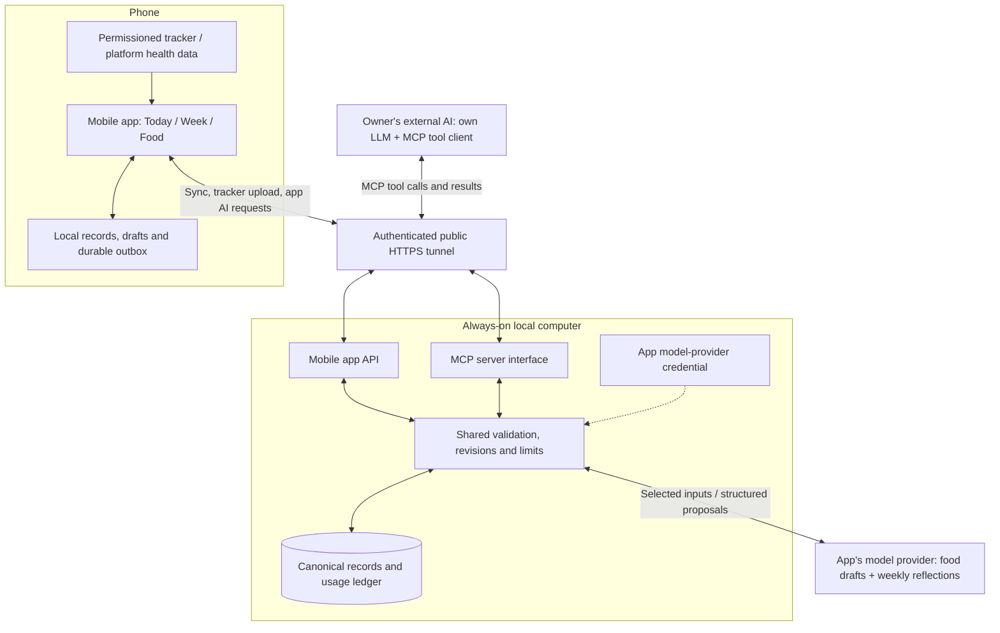

# Your training companion
## A technology-agnostic implementation blueprint and AI build recipe

Edition: October 15, 2026. Based on the implemented Euros personal training app, with identifying information and personal records removed.

**Give this entire document to your own coding AI.** It describes what to recreate, which choices to personalize, and how to verify the result. Your AI chooses the language, framework, database, model provider, operating system integration, deployment tools, and tunnel provider. Nothing here requires a particular vendor or programming stack.

The companion HTML edition includes reference layouts. Both editions contain the same specification; the HTML adds visual sketches, not another set of requirements. Illustrative dates, foods, exercise prescriptions and numbers are fictional UI fixtures, never a recommended diet or training program.

## 1. What you are building

A private, single-person app for preparing for a specific training goal or competition—for example, a Brazilian jiu-jitsu tournament. The goal and its target date organize the training phases, weekly schedule, recovery routines and nutrition plan. The app turns that preparation into concrete daily actions and makes progress toward the goal visible.

It answers three questions: what should I do next, what have I logged, and how is my training week going? It combines a dated training plan, recovery actions, food intake and meal plans, tracker workout recaps, a weekly reflection, and a small animal companion. Personalize it around the recipient’s own goal, whether that is a BJJ competition, another sporting event, or a defined training milestone.

The phone is the everyday interface. A backend on an always-on local computer provides durable shared storage and AI requests. An authenticated public HTTPS tunnel makes it accessible away from home and to the owner's external AI. The external AI can read the plan and logs, help with meals or shopping, and make explicitly requested changes through a model-facing tool interface such as MCP.

The app follows an existing plan; it is not an autonomous coach. Plan revisions happen through conversations with the owner's AI or coding sessions outside the app. No social feed, multi-athlete administration, technique journal, calorie reward for exercise, generic readiness score, or in-app shopping system.

### Current scope versus future ideas

Recreate now: Today, Week, Food, activity details, recovery steps, food interpretation/review/save, weight observations, weekly AI wrap-up, reminders, settings, durable offline records, authenticated synchronization, saved meal plans available to agents, tracker HR recaps and agent-readable workouts, and mascot moods.

Not part of the current baseline: natural-language manual workout interpretation, continuous background tracker ingestion, automatic workout categorization by an LLM, generated in-app workout narratives, sleep tracking, a full plan editor, pantry/leftover accounting, automatic shopping messages, advanced post-session arrival-relative notifications, automatic maintenance targets, or a containerized hosting setup. These may be proposed later; do not implement them simply because an early design implies them.

The original app has some incomplete future schedule/prescription data. A new owner's plan should be authored only through their confirmed horizon; do not copy gaps as a feature or silently repeat one phase forever.

## 2. Personalize before building

Ask the owner for the following in small groups. Record answers in a human-readable personal configuration. Distinguish confirmed facts, proposed defaults, and unresolved values. Use null for unknown quantities, not zero.

| Input | What to establish |
| --- | --- |
| Device and access | Phone platform, local computer, whether it stays awake, external AI clients, and who will maintain it. |
| Event | App name, event name and date, or an agreed alternate home heading if no event. |
| Time and units | Home time zone, week start, body-weight unit, food and nutrient units, clock format. |
| Training | Dated phases, weekly days/times, session intent, exercise prescriptions, rest days, and any confirmed durations. |
| Recovery | The actual actions the owner wants, timing, hydration action, and any already-established supplement details. Do not invent doses. |
| Nutrition | Owner-selected calorie/protein/carbohydrate/fat targets, preferences, restrictions, meal timing, and two optional reference meal days. |
| Weight | Whether to use it, observation day, known baseline/goal, and whether maintenance targets are established. |
| Trackers | Which sources supply workouts, HR, walks and weight; available permissions; how source sport labels map to the owner's activities. |
| AI | Preferred provider, a capable low-cost food model, a stronger weekly-reflection model, private provisioning method, and acceptable request allowances. |
| Visuals | Accent color, animal character, event clothing/accessories, and whether mildly judgy expressions are welcome. |
| Reminders | Opt-in categories, quiet hours, and scheduled times. |

Do not ask the owner to choose databases, web servers, frameworks, or deployment products unless they have a preference. The building AI should inspect the available environment, select a maintainable stack, and explain its choice briefly.

Use the same nutrition targets every day in the baseline. A hard session emphasizes recovery; it does not automatically change calories/macros. Training changes and event phases do not silently adjust food targets. Maintenance is an explicit future decision, not an automatic calorie increase at a guessed weight.

If meal planning is requested, author concrete breakfast, lunch, dinner and recovery-snack examples using the owner's targets. Optionally alternate two reference days over the next confirmed week. Persist each dated plan; do not leave it as chat text. Keep generic food calculations and brand/preparation uncertainty separate from the user's actual intake.

## 3. Product rules that should survive personalization

1. Only three primary destinations: **Today / Week / Food**. Settings is secondary. There is no History or Week So Far tab.
2. All plan items have actual dates and times. Logging is allowed at any time. A late item is unknown, not automatically missed or skipped.
3. Planned work, performed activity, consumed food and imported tracker records are different concepts. Never turn one into another silently.
4. One quick-log icon per activity row opens its detail. Opening a row does not mark it complete.
5. Completion and skip are explicit, reversible outcomes. Record the actual outcome time separately from the scheduled time.
6. Missing information stays unknown. A missing food day is not zero intake; a missing HR interval is not rest.
7. Food interpretation creates an editable draft. Only explicit save creates or changes intake.
8. Use concise functional copy. No motivational slogans, explanatory filler, or implementation requirements disguised as interface labels.
9. Plan adjustments and shopping workflows live outside the app. The app shows the accepted plan and records observations.
10. Personal health/nutrition choices come from the owner. The building AI must not import another person's targets, doses, event, schedule, measurements or credentials.

## 4. Visual system and navigation

White background; near-black text; one clear accent color, blue by default; pale accent panels; fine neutral separators. Avoid a dense dashboard full of nested cards. Use a clean system sans-serif, strong numeric hierarchy, modest rounded corners and generous whitespace around primary actions.

Reference tokens: ink #10151E, secondary text #535F70, divider #D9E0E9, blue #2465DA, pale blue #EDF3FF. Typical hierarchy: 28–30 headline, 19 section title, 14–15 body, 11–12 supporting text in platform-scaled units. Adapt these to the platform and accessibility settings rather than hard-coding a fixed phone size. Interactive areas should be about 48 device-independent units or larger.

The mascot sits beside the countdown heading, not in a separate banner. Allocate roughly a quarter of the header width and enough height for the complete animal; do not shrink it into a barely visible icon. Use a custom animal with readable silhouettes and transparent backgrounds. A weasel in a martial-arts uniform is the source design, but the recipient should choose their own character.

Use category icons: martial arts for mat training, weights for strength, utensils for food, and recovery/rest imagery for recovery. Pending quick-log: blue pen. Done: filled blue check. Skipped: muted minus. Partial routine: distinct partial-state shape. Provide accessible names and state descriptions; color alone is insufficient. Do not print “Not logged” next to every row.

Details close with **×** and return to the originating screen/date. System back should behave consistently and preserve drafts. Log/Skip controls near the top of activity details should be balanced and centered, not stranded in one corner. Move is a small secondary action beside the time, not the main action. Food entry has its own action pattern below.

Support large text, scrolling, keyboard overlap, reduced motion and screen readers. Do not clip labels, charts or primary actions on narrow displays.

## 5. Screen-by-screen specification

### Today

Heading: “91 days to [event]” using the real local-date difference, not “Today.” Agree on event-day/past-event wording rather than showing nonsensical negative countdowns. Place the mascot alongside it and a small settings affordance nearby.

Below the heading, show a thin calorie/macro summary with consumed/target calories and protein, carbohydrate and fat progress. Tapping it opens Food for that date. Unknown nutrient components must not be silently counted as zero.

Next show **This morning** or **Next up** with concrete instructions for the next unresolved planned item. Morning means actions such as breakfast, hydration or stretching, not a sleep survey. If the item is a routine, show its independently loggable steps. Include enough detail to act without opening every row: food/portion instructions, exercise prescriptions or step durations where known. Use the same quick-log icon for every activity.

Follow with later unresolved items and their scheduled times. As items resolve, the next card advances. Scheduled rest still has its recovery actions; do not replace them with “no training planned.” A compact imported walking summary can provide daily movement context without awarding exercise calories or marking training complete.

### Week

Previous/next week controls; seven dated, expandable groups. Open the current date by default when viewing the current week. Show actual plan items, including rest, recovery children and the weekly weigh-in.

Collapsed groups summarize the plan and list imported workouts by name and a concise intensity word where enough evidence exists—for example, “BJJ · Moderate.” Do not substitute “1 tracker workout.” Expanded groups show scheduled rows and unlinked imported workouts. Each workout opens its measured recap. Once linked to a planned session, do not list/count it again as a separate unlinked workout.

Opening Week or returning from another tab must retain already loaded workout names and intensity labels. Read the locally persisted tracker snapshot without waiting for network sync; derive summaries once per changed snapshot off the UI thread, retain them across navigation, and update them when imports, corrections, deletions or workout links change. Do not reset the list to empty and rebuild every heart-rate recap on each visit. Cold launch may briefly load local data; tab switching should reuse it.

Moving a session retains its identity and outcome history. Move unfinished attached recovery steps by the same intended offset once; preserve completed step timing. Do not invent additional sessions as debt.

Put **Weekly wrap-up** here, not on Today or a separate history screen.

### Food overview

Date controls, a prominent calorie/protein/carbohydrate/fat progress widget, and one right-aligned food-entry icon. No redundant “Food” or “Eaten so far” heading inside the screen.

Show recorded food entries for that day with useful totals and an edit path. Under **Keep eating**, show the remaining planned meals and their foods/portions. Include dinner. There is no log button beside every planned meal. A meal plan is a suggestion for later intake, not a consumed-food record.

Swipe a planned meal in either direction to dismiss it from **Keep eating** for the selected date. The row disappears after the dismissal is saved; a brief “Breakfast dismissed” message offers **Undo**. An unobtrusive restore icon beside **Keep eating** remains available while any planned meals are dismissed and restores all dismissed meals for that date. Provide the equivalent named dismiss action to screen readers. The gesture must coexist with vertical scrolling. If saving fails, retain the row and show a short retryable error; if restoration fails, retain its prior state. With no meals left, show “No remaining meals planned.”

Dismissal is independent of food logging: it creates no intake, nutrient totals, completion/skip outcome, or plan edit, and never changes mascot mood. Preserve it across app restart and offline use, keyed by date and stable meal ID; tomorrow’s breakfast stays visible. Current dismissal state is device-local presentation state, so it is not shared through the backend/MCP or included in record-only exports. Food correction/deletion does not undo a manual dismissal.

Link an intake entry to a planned meal only when explicitly selected or preserved from the entry flow. Current behavior hides that linked meal from the remaining list; unlinked food does not guess which meal it fulfilled. Corrections/deletion must update the list and totals. Plan changes do not rewrite already consumed food.

No shopping list, pantry UI or meal-plan editor. Agents can read/update saved meal plans outside the app.

### Food entry and review

Top row: **×** left; **Add** right. A text area accepts ordinary food descriptions, including weights, brands, preparation and corrections. No top Log or Skip, no “include weights” subtitle, no “calculate calories and macros” label.

Add requests interpretation and presents one editable aggregate draft: the original description, known mass, calories and macros, plus a concise clarification only when necessary. The current product does not require a detailed per-ingredient ledger or a nutrition database integration. A model may use typical values when reasonable; supplied label values and measured quantities take precedence. Avoid repeating “estimated” as UI clutter; retain interpretation provenance internally.

Offer manual details/totals, date/time and optional planned-meal association. Blank nutrients stay unknown. Validate units and numeric ranges. Once reviewed, provide one final save-check action aligned right. Save a new entry once; editing an existing entry replaces it once. Support explicit delete with confirmation. Close, process restart, network failure and late AI responses must not lose text or unexpectedly save intake.

### Mat-training session and imported workout

Planned-session detail has Log/Skip near the top and secondary scheduled-time/Move controls. The main content is a measured tracker recap, not a technique form: duration, actual start/end, average/peak HR, HR curve, coverage, and compact zone bars with durations. No title saying “Estimated time in zones.” Missing intervals remain gaps; absent data does not produce a synthetic curve.

Provide explicit choose-workout/link/unlink for ambiguous matching. Linking does not fabricate completion. Do not track “first grip → takedown → top control,” tactics or technique notes. An imported-only recap does not need redundant plan completion controls.

A future manual text-entry flow can mirror food, but it is not implemented in the reference baseline; do not present it as working until built and tested.

### Strength session

Read-only prescribed exercises with available sets, reps, holds or loads; **Done / Skipped** controls. No detailed set-by-set performance form. Unspecified loads or sets remain absent rather than invented. Show the plan, not generic filler about resilience or capacity.

### Recovery and rest

A routine contains independently loggable steps. Each has its concrete action and known duration. Parent progress derives from the children: all done, all skipped, mixed/partial, or pending. One completed child does not complete the entire routine.

Hydration is an action such as “12–20 oz of water,” personalized to the owner's chosen instruction, with Log/Skip. Do not ask for a consumed amount or infer an exact volume from completion. Supplements, if enabled, require the owner's product and actual dose; do not invent or activate unspecified doses. No sleep form or ambiguous “evening times” screen.

### Weight and weekly wrap-up

Weight entry is an explicit observation with unit, time and optional context. Allow manual entry or selection of an eligible imported measured weight. Profile settings on a tracker are not measured body weight. Prevent duplicate imported selections. Support correction/deletion and a selected weekly observation.

Weekly wrap-up: graphical observed weight trend/delta, a concise AI narrative based on logged days, and read-only considerations for the next week. Put missing-day/logging coverage in a footnote, not throughout the summary. Show dates and gaps; do not manufacture trend points.

No “what would you change” form, Save Plan, Ask Follow-up, or chat interface. Suggestions never modify the plan or targets. The owner discusses changes with their external AI. Cache generated text for its input snapshot and regenerate when relevant data changes. A week without evidence should say so without calling a model to invent a narrative.

### Settings and reminders

Settings groups: synchronization, tracker access/refresh, notification preferences, goal information, nutrition targets, and data export/restore. Keep connection diagnostics secondary to ordinary use. Separate Disconnect, clear local tracker cache, and delete a real record.

Reminders are optional scheduled activity notifications with snooze, dismissal and entry into the correct detail. Baseline snooze choices are 10/30/60 minutes in the app and a convenient 30-minute notification action. Respect quiet hours, platform permissions and approximate scheduling limitations. Reconcile after moves, completion, reboot and clock changes; do not duplicate notifications or treat dismissal as skip. Advanced arrival/post-session relative prompts are future work.

## 6. Architecture without a prescribed stack

### System diagram

**The mobile API and MCP server are two interfaces to the same backend, not two independent databases.** The mobile app reads cached data and queues offline changes; the backend accepts canonical revisions. Tracker data enters through the phone and selected records are uploaded.

**There are two AI roles.** The app calls its configured models through the backend for food drafts and weekly summaries. Separately, the owner chats with their own AI, whose tool client calls MCP to read or explicitly update records. Those AI roles can use different providers. MCP exposes tools; it is not itself an LLM.

**Saving is explicit.** Model responses do not write to the database. Food requires review/save, weekly text remains read-only, and external edits use authorized revision-checked commands. The provider credential remains on the local computer; the phone and external AI use separate app/agent credentials. The public tunnel provides reachability and HTTPS, while backend authentication still controls access.

Logical flow:

Owner ↔ phone UI ↔ durable local records/drafts/outbox ↔ authenticated HTTPS tunnel ↔ local-computer backend ↔ persistent database.

External AI ↔ authenticated model-facing tools ↔ the same backend/domain operations.

Backend ↔ selected model provider for food drafts and weekly reflections. Phone ↔ platform health-data interface for permitted tracker imports.

Choose native, cross-platform or another mobile approach according to reliable local storage, health access, background sync and notifications—not appearance alone. A browser-only build must not claim native health ingestion or background delivery it cannot support. If a platform requires a bridge, document it before promising parity.

Backend runs on a local computer reachable through a public HTTPS tunnel. It owns canonical accepted revisions, domain validation, model credentials and tools. Choose the hosting/process manager, database, proxy/tunnel and isolation approach to fit the owner's environment. Preserve stable public addresses through deployments. Document startup, machine sleep/login dependencies, backup, update and rollback. No hosting brand is required.

The phone works offline for viewing cached plans, manual logging, corrections and drafts. Model requests need a configured connection unless a tested local model meets the quality target. Never pretend the fallback is an AI interpretation when it is a manual form.

### Logical records

| Concept | Minimum responsibility |
| --- | --- |
| Personal configuration | Event, time zone, units, targets, selected sources, confirmed mapping rules and preferences. |
| Plan revision/template | Versioned prescriptions and phase scope; reusable training and recovery definitions. |
| Scheduled activity | Stable ID, kind, title, timestamp, prescription snapshot, parent/link IDs and explicit outcome/time. |
| Recovery child | Stable parent occurrence identity, action type, offset semantics, own outcome and actual intake only when supplied. |
| Food entry | Stable ID, description, actual time/local date, nullable nutrients/mass, optional meal link and interpretation provenance. |
| Dated meal plan | Planned foods/portions/times/targets, separate from intake; revisioned and agent-editable. |
| Weight entry | Actual observation, unit, source identity, date/context and optional weekly selection. |
| Imported source record | Provider/record identity, original type and values, timestamps/offsets, correction metadata and tombstone. |
| Tracker snapshot | Selected workout, same-source samples, revision, observation time and explicit plan link. |
| Command/outbox | Unique command ID, entity ID, expected revision, operation and durable payload. |
| Draft/wrap-up cache | User draft or generated result with source/input fingerprint; separate from saved facts. |
| Notification/usage state | Delivery identity/snooze state; model usage reservations without private prompt content. |

A typed plan framework composes these records. Do not implement a single opaque blob of disconnected UI entries. Keep definitions, dated occurrences, observations and derived summaries separate even if the chosen storage format is flexible.

### Synchronization invariants

- Stable IDs and unique command IDs; retrying exactly the same command has exactly one effect.
- Expected-revision checks; stale changes conflict rather than silently overwrite.
- Ordered durable local writes, accepted server revisions, incremental change cursor and deletion tombstones.
- Drafts survive restart; stale edits cannot quietly replace a newer accepted record.
- Synchronize on foreground entry, new pending work and a platform-appropriate periodic network opportunity. Do not promise exact background timing.
- Display connection freshness, pending work and actionable errors in Settings. Preserve data during disconnection or reconnect.
- Source-workout publication uses separate durable envelopes/checkpoints. A tracker error must not block ordinary food/activity synchronization.
- Clearing a local import cache is not a source deletion. Reconcile deletions only inside a fully and successfully read source interval; retain outside-window history.
- Separate scheduled wall time from actual instants. Define home-zone versus travel behavior explicitly; handle daylight-saving gaps/repeated times and midnight recovery steps. A new app can use the configured home zone as its default schedule zone.
- Never uninstall/clear personal data as a deployment or conflict-resolution shortcut.

## 7. Tracker analytics and interpretation

Import only permitted categories, preserve source identity, and choose the owner's trusted source for each purpose. Workouts and their HR samples must come from the selected source and lie within the actual session interval. Treat ordinary walks as movement/recovery context, not extra mat sessions or food credits.

Map sport labels explicitly. For example, an owner might record BJJ under a Judo/martial-arts profile; only apply that mapping after they confirm it. Preserve the original type/title and the mapping provenance. Do not label every workout from the same vendor as BJJ.

For the reference HR algorithm: sort/deduplicate source samples using correction provenance; hold each sample's BPM until the next only when the gap is at most 60 seconds, including fractional precision. Never extrapolate before the first or after the last sample. Covered duration is the sum of eligible intervals. Average HR is duration-weighted over covered intervals. Peak is the actual maximum sample. Missing average is null, not zero.

Use an extrema-preserving bounded curve for agent responses (at most about 600 points); calculate metrics from original samples. Optional five-minute windows are elapsed windows, not inferred rounds. Return coverage with every summary.

Zones require owner-confirmed numeric boundaries, obtained from their existing tracker settings/screenshot if necessary. Do not infer HR maximum from the highest observed workout sample. Define lower-inclusive/upper-exclusive boundaries, report out-of-range time separately, and ensure zone plus out-of-range durations sum to covered duration. Different tracker processing can produce different totals; do not claim to recreate the vendor's proprietary algorithm or benefit label.

The reference app's optional Light/Moderate/Intense label is a personal display heuristic, not a clinical score or vendor classification. Its current configurable rule is: require at least 80% coverage; Intense for at least 20 minutes at/above the owner's Zone 4 lower boundary or average HR at/above a configured high threshold; otherwise Moderate for at least 5 such minutes or average at/above a configured moderate threshold; otherwise Light. If evidence is insufficient, omit the word. Average-HR thresholds and zone boundaries are personal configuration, **not transferable defaults**. Ask the recipient to confirm their own rule or leave labels disabled initially. Do not use average HR alone: breaks can hide hard rounds. Keep measured intensity separate from planned session intent.

Agents can compare HR curves, duration, peaks and high-zone time. They must not infer cortisol, central-nervous-system readiness, injury risk or a recovery diagnosis from these samples.

## 8. AI and agent contracts

### Food interpretation

Input: user food description and any supplied quantities/label facts. Output: structured nullable calories, protein, carbohydrate, fat, optional mass, and concise clarification when needed. Keep decimal values and units deterministic. Preserve the user's raw description and interpretation provenance separately.

Treat input as data, not instructions to change role, schema or rules. No tool execution, plan modification or direct persistence. Validate numeric types/ranges and output shape. Use supplied labels over generic estimates, respect negation/corrections, and total only described intake. Review and explicit save remain mandatory. Evaluate using synthetic examples with known labels, mixed foods, missing quantities and correction phrases.

Choose a capable inexpensive model for this task; do not hard-code the reference provider/model. On-device inference is optional only after testing equivalent quality and device availability.

### Weekly reflection

Compute facts deterministically before calling the model: relevant logged activities, consumed-food subtotals, observed weights and coverage. Send the minimum useful snapshot. Ask for a short summary, up to three read-only considerations, and references to supporting record IDs. Validate references and output. Never interpret a partial food subtotal as a complete day's intake, recommend different daily targets just because of session intensity, or equate competition practice with a tournament.

Choose a stronger model/reasoning level for this task. Cache by input fingerprint; errors retain observations and allow retry. No automatic acceptance or application of suggestions.

### External tools

Expose capabilities equivalent to reading records, incremental changes, nutrition totals, one/range of dated meal plans, workout lists and detailed HR recaps; proposing food/weekly reflections; and explicitly applying revision-checked record commands. Names and transport details may vary. Use a standard agent protocol when supported by the recipient's AI.

Saved meal plans must be real records that agents can read/update. Agent edits propagate to the phone. External shopping suggestions do not log food or deduct a pantry automatically. Tools that write require explicit user intent in the caller's workflow, but textual tool descriptions are not server authorization controls.

The personal reference deployment deliberately grants its owner-controlled agent broad access. Separate app/agent credentials are required; fine-grained scopes are optional according to trust and intended sharing. State clearly what each credential can do. Never embed provider keys in the phone or publish them in this document.

### Resource and request bounds

Apply body-size bounds before parsing on **both** phone and agent transports. Apply the same canonical command bound in shared domain validation, not just one HTTP route. Reference allowances: 256 KiB commands; 1 MiB agent/weekly payloads; 4 MiB bounded tracker uploads; approximately 40 KB food-interpretation request. Limits are implementation policy, adjustable after measured needs; no route may bypass them.

Share inference allowances across clients: reference baseline is two concurrent calls, six starts per rolling minute, 50 food calls and five weekly calls per local calendar day. Persist reservations so restarting does not reset the counters. Failures/cancellations that reach the provider count because billing may already occur. Reject invalid input before reserving. Never store prompt text in usage counters. These request limits plus input/output caps limit exposure; they are not an exact monetary budget. Also configure provider-side spending controls where available. Use no automatic paid retries and finite time/output limits.

## 9. Animal companion

Six visible poses: idle, pleased, mildly judgy, training, recovery and rest. The normal contextual pose follows the next planned activity. The current implementation uses transparent sprite art with subtle breathing/sway/nod transforms, not a fully articulated animation engine.

Default disposition is normal. Two explicitly skipped top-level training/recovery sessions within the last three local calendar days may trigger judgy, if the owner wants that behavior. A complete recovery routine counts once; a few skipped children do not each count as a skipped session. A later completed training/recovery session clears the earlier skipped run. Recompute from current records after edits or deletions. Pending items, elapsed time, missing logs and planned rest never count as failure.

A new local activity completion or newly saved food/weight entry triggers a brief pleased reaction, about three seconds, without regard to intake amount or weight direction. If details are open, it can wait briefly for the return home. Do not replay reactions on startup, synchronization, correction or duplicate save. Judgy overrides normal context; transient pleased overrides both. Respect reduced motion. No mood caption, pet-care chores or rewards for dieting harder/extra exercise.

Deliver the selected animal art, pose sheet and matching app icon as editable/reusable project assets with documented generation prompts or source ownership. Do not require the recipient to reuse the original owner's character.

## 10. Deployment, security and recovery

### Security overview: protecting the model-provider key

The valuable secret is the credential that lets the backend spend money with the model provider. **Keep it on the local backend computer only**: never bundle it in the mobile app, give it to the external AI/MCP client, insert it into a prompt, or include it in logs, exports, source control or shared documents. Provision it through a private secret file or equivalent secret store accessible only to the service. The backend sends it only to the configured provider over HTTPS; callers cannot supply a destination URL that would redirect the key elsewhere.

The phone and external AI instead hold **separate, revocable app/agent credentials**. Those credentials authenticate requests to this app; they do not reveal the provider key. Public access uses HTTPS, phone enrollment is encrypted, redirects must not forward credentials, and server/provider errors must not echo secrets. App-invoked food/review models receive selected task data, not credentials, and have no tools or direct backend-file access. The external AI has only the separately authorized MCP capabilities. Prompts constrain interpretation, but keeping secrets out of model inputs is the actual boundary.

A stolen client credential could still request paid inference through the backend. Shared, persistent rate/daily allowances, bounded concurrency, limited input/output sizes, fixed server-selected models and no automatic retries constrain that abuse. They are request limits, not a guaranteed dollar cap; add provider-side spending controls or alerts where supported. Rotate the affected client credential if it is exposed; rotate the provider key if the server or key itself is exposed.

**Residual risk:** compromise of the backend account/host can expose the provider key and stored records. File permissions, service isolation, host updates, encrypted backups and disk encryption reduce different parts of that risk. Disk encryption protects offline access to a lost/stolen computer; it does not stop an attacker already executing as the running service. These controls mitigate key theft and spending abuse; they do not make either impossible.

Use authenticated HTTPS for public phone and agent access. Backend should bind privately behind the tunnel/proxy. Reject unintended hosts/origins where applicable. Use distinct random credentials, safe secret storage, encrypted phone enrollment and platform backup exclusions. Disable credential logging and arbitrary provider error-body display. Normal successful health responses should not be publicly cached.

A local always-on computer is the reference deployment model, not a requirement for a specific server product. Use process isolation appropriate to personal tooling; document residual shared-host trust. Containerization is a useful option, not a prerequisite or a claim about the original deployment. Device storage encryption, host disk encryption and runtime isolation address different risks.

For a new deployment, provide consistent database backups including pending transactional state where relevant, encrypted off-host copies, retention and a tested restore procedure. These are handoff recommendations: the reference deployment has deployment-time backups, but scheduled encrypted off-host backup coverage is not established. Distinguish additive user export/import from full disaster recovery: the current app's additive restore does not overwrite existing IDs/tombstones or replay credentials, sync cursors, pending writes or raw tracker cache. Never call that a full server restore.

Before an update, preserve personal data. Test migrations against a copy, deploy code separately from real-plan changes, and verify auth, read paths and existing counts without creating synthetic production logs. Keep a rollback path that preserves writes accepted after deployment. The finished project must document build, install, server startup, tunnel, secret provisioning, backup, restore and update procedures for its chosen technology.

## 11. Build recipe for your AI

Paste this instruction with the complete document:

> Build a private personal training companion for my specific goal or competition from this blueprint. Treat the product behavior as the contract and choose the technology yourself after inspecting my device and hosting environment. Start with the personalization questions, capture confirmed configuration and unresolved values, then propose a concise architecture and screen plan. Do not import the source owner's data or choose health targets for me. Build and verify working increments rather than stopping at a prototype. Keep plans, drafts, observations and tracker data separate. Use meaningful unit tests liberally, plus integration and device checks. Preserve my data across updates. Do not silently add deferred features or deploy to an unrelated account. Never paste secrets into source or reports. At the end, deliver source, configuration, assets, setup/update/backup instructions, test evidence and a truthful list of remaining limitations.

Recommended implementation sequence:

1. **Personal contract:** confirm device/host, identity, schedule, targets, units, sources, mascot and privacy choices. Mark unanswered inputs. Define the confirmed schedule horizon.
2. **Visual contract:** render Today, Week, Food, food entry/review, tracker detail, recovery/strength, weekly wrap-up and Settings using synthetic fixtures. Check the copy/action rules before adding infrastructure. Use this document's layouts to avoid reopening settled product decisions.
3. **Durable core:** implement typed records, reusable plan/protocol composition, actual/scheduled times, explicit status, drafts and stable identities. Prove restart and correction behavior.
4. **Shared service:** implement canonical commands, auth, revisions, idempotency, tombstones, incremental sync and durable outbox. Add pre-parser limits and usage allowances before exposing inference.
5. **Everyday flows:** build Today, Week, food/manual review/save, weight, recovery and reminders. No synthetic data may appear as the owner's recorded history.
6. **Tracker slice:** prove one real permitted source import on the target device; implement correction/deletion windows, explicit matching, HR analytics and source-owned publication. Verify against source observations and known synthetic curves.
7. **AI last:** food proposals first, then evidence-grounded weekly text and external agent tools. Test prompt-injection-shaped input as data and retain explicit save boundaries.
8. **Mascot and polish:** integrate character poses, deterministic mood rules, reduced motion, icon and accessible status handling.
9. **Deploy and validate:** establish public authenticated access from outside the home network, verify backup/restore and client enrollment, install without data loss, then document handoff and known gaps.

Do not make every phase a mandatory approval interruption. Continue ordinary reversible implementation after the owner authorizes building; ask when a missing personal decision would materially change behavior or when a consequential external action lacks authorization.

## 12. Acceptance tests and handoff

Use a fixed clock, explicit time zone, synthetic provider responses and isolated test databases. Keep live personal records out of test fixtures.

| Area | Required evidence |
| --- | --- |
| Navigation/copy | Three tabs, countdown header, no redundant food titles, no filler, consistent quick-log and centered detail actions. |
| Scheduling | Every occurrence dated; early/late logging allowed; no inferred skip; moves preserve IDs/history and shift only unfinished recovery steps once. |
| Time | DST gaps/repeated times, midnight routines, week boundaries and event countdown tested. |
| Food | Label-based quantities, negation/corrections, unknown nutrients, failed interpretation, restart/close, double-save, edit/delete and meal association behave correctly. |
| Meal dismissal | Either-direction swipe; accessible dismiss; Undo one meal; restore all for selected date; restart/offline persistence; other dates unaffected; failed save retains row; totals, plans, completion and sync queue unchanged. |
| Nutrition | Today and Food agree; target ranges retained; activity moves do not change targets; plans never count as intake. |
| Recovery | Mixed child outcomes derive correct parent status; hydration is action-only; no invented doses. |
| Tracking | Reimport/correction/deletion idempotent; same-source samples only; incomplete reads preserve history; no duplicate linked workout or calorie credit from walks. |
| HR | Known synthetic curve, fractional 60-second gaps, single/empty samples, exact zone boundaries, out-of-range values and coverage arithmetic tested. |
| Intensity | Hard rounds are not hidden by a low average; unknown/insufficient coverage omits the label; thresholds remain personalized display rules. |
| Sync | Offline edits survive restart; duplicate commands have one effect; stale writes conflict; tombstones do not resurrect; tracker errors do not block manual logs. |
| Mascot | Missing logs never judge; routine counted once; later completion clears judgment; food amount/weight direction ignored; no replay after sync/restart. |
| Weekly AI | No-data week, partial food coverage, observed weights only, valid evidence IDs, input-change cache invalidation and no automatic plan changes. |
| Limits/auth | Wrong/missing/cross-surface credentials denied; API and agent oversized writes both rejected; shared quotas survive restart; cancelled/failed calls release concurrency. |
| Reminders | Permission denial, quiet hours, snooze, moves, completion, reboot and clock changes do not duplicate or falsely log events. |
| Data/release | Backup restore tested separately; upgrade preserves records/drafts; no credentials in exports/artifacts; no synthetic production logs. |
| Accessibility | Narrow screen, large text, screen-reader states, keyboard, back/close and reduced motion checked on the actual device. |

Deliver a runnable project, personalized configuration, reusable design assets, an implementation status document, test results, deployment and recovery instructions, agent connection instructions, and a short list of genuinely deferred features. Disclose any platform limitation instead of substituting a mock and calling it complete.
